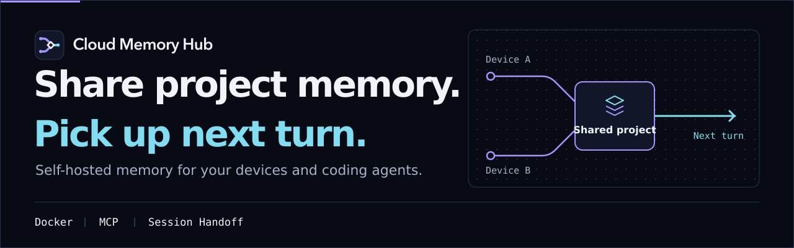
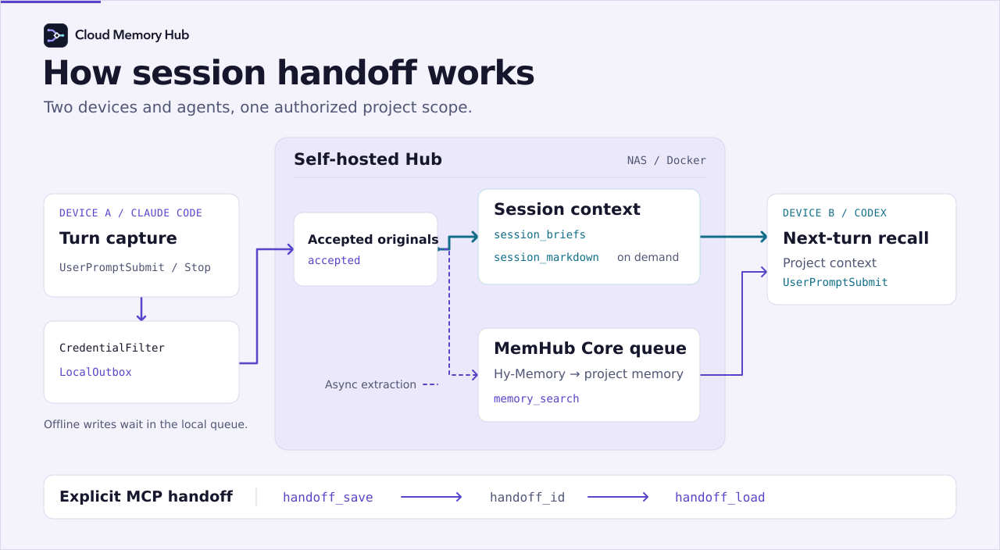

<h1 align="center">Cloud Memory Hub</h1>

<p align="center">
  
</p>

<p align="center"><strong>共享项目记忆，接续下一轮。</strong><br>
Share project memory. Pick up next turn.</p>

<p align="center">
  <a href="https://github.com/Tsou92/Cloud-Memory-Hub/releases/latest"></a>
  <a href="LICENSE"></a>
  <a href="https://github.com/Tsou92/Cloud-Memory-Hub/actions/workflows/quality.yml"></a>
  <a href="docs/agent-access.md"></a>
  <a href="https://memoryhub.tsounas.cn"></a>
</p>

Cloud Memory Hub 是可部署在 **NAS 或本机 Docker** 上的开源服务。设备配对到同一个项目后，已启用项目钩子的 Agent 可在下一轮召回相关会话摘要。需要更多细节时可读取已采集的 Markdown 原文，通用 MCP 也支持显式读写和交接。

Cloud Memory Hub is an open-source, self-hosted service for sharing project memory across authorized devices and agents. Supported hosts can recall session context on the next turn. MCP tools also let agents save and load task handoffs explicitly.

[产品主页](https://memoryhub.tsounas.cn) · [快速接入](#在-nas-安装发行版) · [MCP 配置](#mcp-setup) · [接入指南](docs/client-installation.md) · [问题反馈](https://github.com/Tsou92/Cloud-Memory-Hub/issues)

## 为什么用它

| 常见场景 | 单机／单 Agent 会话 | Cloud Memory Hub |
| --- | --- | --- |
| 在 Claude Code 定下方案，改用另一台电脑上的 Codex | 需要重新解释目标和已完成的工作 | 同项目、已配置钩子的 Codex 可在下一轮召回相关会话摘要 |
| 本轮结束时网络暂时不可用 | 依赖当前设备的上下文和记录 | 已过滤的事件保存在本地待传队列，重连后补传 |
| 想让另一端按原进度继续任务 | 手动复制下一步和阻塞事项 | 用 MCP 保存结构化交接，由同项目授权的设备按 `handoff_id` 读取 |

## 会话如何接续

[](assets/brand/architecture-handoff.svg)

1. **本地排队。** Claude Code 的项目钩子捕获获准的可见提示和最终回答，经凭证过滤后写入 `LocalOutbox`。
2. **Hub 接纳。** 连接组件提交事件，Hub 核验设备、项目与来源授权，按稳定事件身份处理重投，返回持久回执。
3. **下一轮召回。** 另一台设备上的 Codex 通过已启用的项目钩子召回相关摘要 `session_briefs`。需要详情时，用 `session_markdown` 分页读取。
4. **异步长期记忆提炼。** 配置模型后，MemHub Core 队列在后台提炼长期记忆，产物可通过 `memory_search` 查询。会话摘要在原文接纳后即可读取。
5. **显式 MCP 交接。** 需要指定交接时，A 端可独立调用 `handoff_save` 保存目标、进展和下一步，B 端用接纳后返回的 `handoff_id` 调用 `handoff_load`。

> **实验版本。** 请保留独立记忆来源。完整历史自动导入目前按 `source_root` 显式支持 Claude Code／Codex／DSH 会话。附件解析目前限历史导入时可选的本地 PDF 文本层与纯文本抽取。断网时显式读取只可使用本机上次成功读到的缓存副本，跨端自动召回需要在线。外部模型的数据流向见[数据与隐私](docs/data-and-privacy.md)。

<a id="在-nas-安装发行版"></a>

## 🚀 一条命令部署 NAS

在 NAS 开启 Docker Compose 和 SSH，并准备已登录的 Tailscale 或可访问的 HTTPS 入口。NAS 上还需要 `curl`、`sha256sum`、`tar`、`flock` 和 `python3`，安装器只检查、不代装。在任意目录运行对应电脑系统的命令，把 `USER@NAS` 换成 NAS 的 SSH 用户名与地址，或已有的 SSH 别名。

命令使用 [v0.1.17 的正式附件](https://github.com/Tsou92/Cloud-Memory-Hub/releases/tag/v0.1.17)。

<!-- website-install:nas -->

**Mac / Linux 终端**

```sh
(cmh_installer=$(mktemp) && trap 'rm -f "$cmh_installer"' 0 && cmh_fetch() { curl -q -fsSL --proto '=https' --proto-redir '=https' --connect-timeout 12 --max-time 45 "$@" https://raw.githubusercontent.com/Tsou92/Cloud-Memory-Hub/v0.1.17/scripts/bootstrap-install.sh -o "$cmh_installer"; } && (cmh_fetch || cmh_fetch --noproxy '*') && sh "$cmh_installer" --nas USER@NAS --nas-only)
```

**Windows PowerShell**

```powershell
& ([scriptblock]::Create((Invoke-WebRequest -UseBasicParsing -ErrorAction Stop -TimeoutSec 60 -MaximumRedirection 0 'https://raw.githubusercontent.com/Tsou92/Cloud-Memory-Hub/v0.1.17/scripts/bootstrap-install.ps1').Content)) -Nas 'USER@NAS'
```

<!-- /website-install -->

也可以把填好 NAS 地址的命令发给能运行对应终端的 Agent，请它原样执行一次，等安装器返回后告诉你管理页地址或具体错误。安装器负责环境检查、下载、校验和启动。

1. 等安装器输出管理页地址。首次运行需要下载并导入镜像。
2. 在安装器打开的初始化页输入 `admin`，设置自己的新密码后进入后台。
3. 在后台创建项目，进入「设备与接入」，用页面生成的命令或话术配对。

安装器会识别 NAS 上的原生 Tailscale 或单个官方 Tailscale 容器。[首装参数与手动部署](docs/nas-installation.md) · [已有实例升级](docs/development-runtime.md#已有实例升级保持配置和身份)

<details>
<summary>没有 NAS？部署到本机 Docker</summary>

启动 Docker Engine 或 Docker Desktop，并使用 Linux 容器。管理页默认是 `http://127.0.0.1:8800/hub`，仅本机可访问。

<!-- website-install:local -->

**Mac / Linux 终端**

```sh
(cmh_installer=$(mktemp) && trap 'rm -f "$cmh_installer"' 0 && cmh_fetch() { curl -q -fsSL --proto '=https' --proto-redir '=https' --connect-timeout 12 --max-time 45 "$@" https://raw.githubusercontent.com/Tsou92/Cloud-Memory-Hub/v0.1.17/scripts/bootstrap-install.sh -o "$cmh_installer"; } && (cmh_fetch || cmh_fetch --noproxy '*') && sh "$cmh_installer" --local)
```

**Windows PowerShell**

```powershell
& ([scriptblock]::Create((Invoke-WebRequest -UseBasicParsing -ErrorAction Stop -TimeoutSec 60 -MaximumRedirection 0 'https://raw.githubusercontent.com/Tsou92/Cloud-Memory-Hub/v0.1.17/scripts/bootstrap-install.ps1').Content)) -Local
```

<!-- /website-install -->

</details>

## 🔌 三步使用

1. **生成连接。** 在 Hub 的「设备与接入」中选择项目、填写设备名称并选择 Agent。每台电脑分别生成链接，共享同一个项目。
2. **安装连接。** 在目标电脑运行页面生成的一条命令，或把安装话术交给 Agent。Apple Silicon Mac 上的 Claude Code CLI 和 Codex 默认准备专用共享目录。要沿用已有项目，可以先在 Agent 中打开项目，再把话术发给它。
3. **开始共享。** 在 Agent 中打开安装结果显示的目录。Codex 首次按界面提示信任已安装的钩子一次，然后正常对话即可。另一端先收到会话摘要，需要细节时再读 Markdown 原文。其他宿主可通过 MCP 接入。详见[接入指南](docs/client-installation.md)。

会话接续传递任务上下文。通用 MCP 也提供显式读取和交接工具；本机旧历史与其他宿主的采集范围见[接入指南](docs/client-installation.md)。

<a id="mcp-setup"></a>

## 配置 Claude Code 和 Codex 的 MCP

**默认走一次性链接。** 在 Hub 的「设备与接入」为 Claude Code 或 Codex 生成连接，复制页面给出的安装命令到目标电脑，然后重新加载 MCP。打开安装结果显示的项目目录，检查工具列表能否看到 `session_briefs` 和 `handoff_save`。在支持的宿主上，自动召回由项目钩子触发，Codex 首次需要按宿主提示审查并信任钩子。

<details>
<summary>手动配置 Mac 客户端（JSON / TOML）</summary>

先安装 Mac 客户端并在 Hub 下载本设备的配对文件。替换以下占位路径，再用导入后返回的 `config_file` 生成配置。将对应输出合并到既有客户端配置。

```sh
"/path/to/installed/bin/cloud-memory-setup" import --pairing-file "/path/to/downloaded-pairing.json"
"/path/to/installed/bin/cloud-memory-setup" mcp-config --config-file "/path/to/private/agent.json"
"/path/to/installed/bin/cloud-memory-setup" mcp-config --config-file "/path/to/private/agent.json" --format codex
```

**Claude Code（JSON）**

```json
{
  "mcpServers": {
    "cloud-memory-hub": {
      "command": "/path/to/installed/bin/cloud-memory-mcp",
      "args": ["--config-file", "/path/to/private/agent.json"]
    }
  }
}
```

**Codex（TOML）**

```toml
[mcp_servers.cloud-memory-hub]
command = "/path/to/installed/bin/cloud-memory-mcp"
args = ["--config-file", "/path/to/private/agent.json"]
```

连接凭证由已配对的私有配置管理。完成配置后重新加载 MCP 或打开新会话。远程 HTTP MCP、Linux／Windows 接入及本地补传见[客户端文档](docs/client-installation.md)，工具参数与授权见 [Agent 接入文档](docs/agent-access.md)。

</details>

## ✅ 当前支持范围

| 能力 | 已做到什么 |
| --- | --- |
| 跨设备共享与交接 | 已有真实 NAS、两台 Mac 的 MCP 读写与任务交接验证；不同版本的复验范围见[验收记录](docs/reviews/2026-11-10-final-artifact-acceptance.md)。 |
| Claude Code CLI / Codex 桌面 | Apple Silicon Mac 可安装项目钩子。Codex 桌面已在 NAS 上用两个真实聊天验证自动上传与接续；新项目首次按宿主提示信任钩子。 |
| 更多 Agent | 提供通用 MCP / Skill 接口；OpenCode、Hermes 等可按接口接入，但尚未完成所有宿主的读写实测。 |
| 网页与备份 | 管理项目、记忆、原文、设备连接和备份；恢复操作与演练范围见[备份与恢复](docs/backup-and-recovery.md)。 |

记忆提炼需要可用的模型接口。使用外部 API 时，相关内容会发送给你配置的服务商；密钥只填在自己的 Hub 设置页，不要放进共享记忆或公开仓库。

## 📚 常用文档

| 想做什么 | 去这里 |
| --- | --- |
| 首次部署、升级或排查 NAS 服务 | [让 Agent 帮你安装](docs/nas-installation.md) · [运行指南](docs/development-runtime.md) |
| 连接 Agent、启用高级本地采集 | [设备与 Agent 接入](docs/client-installation.md) · [自动召回](docs/agent-recall.md) |
| 配置备份、恢复历史版本 | [备份与恢复](docs/backup-and-recovery.md) |
| 了解数据存在哪、何时发给外部模型 | [数据会去到哪里](docs/data-and-privacy.md) |
| 忘记后台密码 | [重置管理员密码](docs/development-runtime.md#忘记管理员密码) |
| 查看已完成与待完成能力 | [发布计划](docs/release-plan.md) · [需求说明](docs/requirements.md) |
| 参与开发或报告安全问题 | [贡献指南](CONTRIBUTING.md) · [工程规范](docs/engineering.md) · [安全说明](SECURITY.md) |

<details>
<summary>实测证据、架构与开发检查</summary>

历史记录保留各自的版本与测试边界，不等同于每个新发行包都已覆盖全部场景。

| 内容 | 入口 |
| --- | --- |
| 正式制品与真实设备验收 | [最终制品验收](docs/reviews/2026-11-10-final-artifact-acceptance.md) · [一次性链接接入](docs/reviews/2026-11-10-one-link-onboarding.md) |
| 双机、Claude CLI 与自动召回 | [客户端实测](docs/reviews/2026-11-10-self-service-clients.md) · [下一轮与重连](docs/reviews/2026-11-10-next-turn-and-reconnect.md) |
| 网页、模型与恢复 | [首次网页使用](docs/reviews/2026-11-10-browser-first-use.md) · [模型配置](docs/reviews/2026-11-10-model-catalog.md) · [自动备份](docs/reviews/2026-11-10-managed-backup.md) |
| 架构与上游复用 | [架构](docs/architecture/overview.md) · [Hy-Memory / MemHub 复用清单](docs/research/upstream-assessment.md) |
| 官网与品牌物料 | [产品主页](https://memoryhub.tsounas.cn) · [品牌规范与素材](docs/brand/BRAND_GUIDELINES.md) |
| 审计与修复 | [2026-11-16 审计修复](docs/reviews/2026-11-16-audit-fixes.md) |
| 完整测试与历史设计记录 | [验证计划](docs/verification.md) · [开发及运行检查](docs/development-runtime.md#可复现验证) |

开发前阅读[贡献指南](CONTRIBUTING.md)。基础检查为 `make check`；运行时、上游、容器与真实 Agent 验收按变更分别执行，基础检查通过不代表所有产品能力都已验收。

</details>

## 许可证与致谢

自有源码采用 **Apache-2.0**，见 [LICENSE](LICENSE) 和 [NOTICE](NOTICE)。记忆核心复用 [Hy-Memory / MemHub](https://github.com/Tencent-Hunyuan/Hy-Memory)，固定上游版本、补丁及第三方许可随发行保留。
