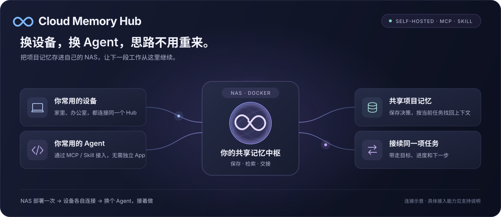

# Cloud Memory Hub

**让不同设备和 AI Agent，共享项目记忆、接续任务。**

服务通过 **Docker 部署在自己的 NAS**，电脑无需安装独立 App。

在电脑运行一条命令，即可部署 NAS 服务。然后在后台创建共享项目并配对设备。

[](https://github.com/Tsou92/Cloud-Memory-Hub/releases/latest)
[](LICENSE)
[](docs/development-runtime.md#发行版首次运行)
[](https://github.com/Tsou92/Cloud-Memory-Hub/actions/workflows/quality.yml)



[产品主页](https://memoryhub.tsounas.cn) · [下载发行版](https://github.com/Tsou92/Cloud-Memory-Hub/releases/latest) · [接入指南](docs/client-installation.md) · [问题反馈](https://github.com/Tsou92/Cloud-Memory-Hub/issues)

<a id="在-nas-安装发行版"></a>

## 🚀 一条命令部署 NAS

在 NAS 开启 Docker Compose 和 SSH，并准备已登录的 Tailscale 或可访问的 HTTPS 入口。在任意目录运行对应电脑系统的命令，把 `USER@NAS` 换成 NAS 的 SSH 用户名与地址，或已有的 SSH 别名。

命令使用 [v0.1.6 的正式附件](https://github.com/Tsou92/Cloud-Memory-Hub/releases/tag/v0.1.6)。

**Mac / Linux 终端**

```sh
(cmh_installer=$(mktemp) && trap 'rm -f "$cmh_installer"' 0 && cmh_fetch() { curl -q -fsSL --proto '=https' --proto-redir '=https' --connect-timeout 12 --max-time 45 "$@" https://raw.githubusercontent.com/Tsou92/Cloud-Memory-Hub/v0.1.6/scripts/bootstrap-install.sh -o "$cmh_installer"; } && (cmh_fetch || cmh_fetch --noproxy '*') && sh "$cmh_installer" --nas USER@NAS --nas-only)
```

**Windows PowerShell**

```powershell
& ([scriptblock]::Create((Invoke-WebRequest -UseBasicParsing -ErrorAction Stop -TimeoutSec 60 -MaximumRedirection 0 'https://raw.githubusercontent.com/Tsou92/Cloud-Memory-Hub/v0.1.6/scripts/bootstrap-install.ps1').Content)) -Nas 'USER@NAS'
```

也可以把填好 NAS 地址的命令发给能运行对应终端的 Agent，请它原样执行一次，等安装器返回后告诉你管理页地址或具体错误。安装器负责环境检查、下载、校验和启动。

1. 等安装器输出管理页地址。首次运行需要下载并导入镜像。
2. 在安装器打开的初始化页输入 `admin`，设置自己的新密码后进入后台。
3. 在后台创建项目，进入「连接 Agent」，用页面生成的命令或话术配对。

安装器会识别 NAS 上的原生 Tailscale 或单个官方 Tailscale 容器。[首装参数与手动部署](docs/nas-installation.md) · [已有实例升级](docs/development-runtime.md#已有实例升级保持配置和身份)

## 🔌 三步使用

1. **生成连接。** 在 Hub 的「连接 Agent」中选择项目、填写设备名称并选择 Agent。每台电脑分别生成链接，共享同一个项目。
2. **安装连接。** 在目标电脑运行页面生成的一条命令，或把安装话术交给 Agent。Apple Silicon Mac 上的 Claude Code CLI 和 Codex 默认准备专用共享目录。要沿用已有项目，可以先在 Agent 中打开项目，再把话术发给它。
3. **开始共享。** 在 Agent 中打开安装结果显示的目录。Codex 首次按界面提示信任已安装的钩子一次，然后正常对话即可。另一端先收到会话摘要，需要细节时再读 Markdown 原文。其他宿主可通过 MCP 接入。详见[接入指南](docs/client-installation.md)。

会话接续传递任务上下文。通用 MCP 也提供显式读取和交接工具；本机旧历史与其他宿主的采集范围见[接入指南](docs/client-installation.md)。

## ✅ 当前支持范围

| 能力 | 已做到什么 |
| --- | --- |
| 跨设备共享与交接 | 已有真实 NAS、两台 Mac 的 MCP 读写与任务交接验证；不同版本的复验范围见[验收记录](docs/reviews/2026-11-10-final-artifact-acceptance.md)。 |
| Claude Code CLI / Codex 桌面 | Apple Silicon Mac 可安装项目钩子。Codex 桌面已在 NAS 上用两个真实聊天验证自动上传与接续；新项目首次按宿主提示信任钩子。 |
| 更多 Agent | 提供通用 MCP / Skill 接口；OpenCode、Hermes 等可按接口接入，但尚未完成所有宿主的读写实测。 |
| 网页与备份 | 管理项目、记忆、原文、设备连接和备份；恢复操作与演练范围见[备份与恢复](docs/backup-and-recovery.md)。 |

记忆提炼需要可用的模型接口。使用外部 API 时，相关内容会发送给你配置的服务商；密钥只填在自己的 Hub 设置页，不要放进共享记忆或公开仓库。

## 📚 常用文档

| 想做什么 | 去这里 |
| --- | --- |
| 首次部署、升级或排查 NAS 服务 | [让 Agent 帮你安装](docs/nas-installation.md) · [运行指南](docs/development-runtime.md) |
| 连接 Agent、启用高级本地采集 | [设备与 Agent 接入](docs/client-installation.md) · [自动召回](docs/agent-recall.md) |
| 配置备份、恢复历史版本 | [备份与恢复](docs/backup-and-recovery.md) |
| 查看已完成与待完成能力 | [发布计划](docs/release-plan.md) · [需求说明](docs/requirements.md) |
| 参与开发或报告安全问题 | [贡献指南](CONTRIBUTING.md) · [工程规范](docs/engineering.md) · [安全说明](SECURITY.md) |

<details>
<summary>实测证据、架构与开发检查</summary>

历史记录保留各自的版本与测试边界，不等同于每个新发行包都已覆盖全部场景。

| 内容 | 入口 |
| --- | --- |
| 正式制品与真实设备验收 | [最终制品验收](docs/reviews/2026-11-10-final-artifact-acceptance.md) · [一次性链接接入](docs/reviews/2026-11-10-one-link-onboarding.md) |
| 双机、Claude CLI 与自动召回 | [客户端实测](docs/reviews/2026-11-10-self-service-clients.md) · [下一轮与重连](docs/reviews/2026-11-10-next-turn-and-reconnect.md) |
| 网页、模型与恢复 | [首次网页使用](docs/reviews/2026-11-10-browser-first-use.md) · [模型配置](docs/reviews/2026-11-10-model-catalog.md) · [自动备份](docs/reviews/2026-11-10-managed-backup.md) |
| 架构与上游复用 | [架构](docs/architecture/overview.md) · [Hy-Memory / MemHub 复用清单](docs/research/upstream-assessment.md) |
| 完整测试与历史设计记录 | [验证计划](docs/verification.md) · [开发及运行检查](docs/development-runtime.md#可复现验证) |

开发前阅读[贡献指南](CONTRIBUTING.md)。基础检查为 `make check`；运行时、上游、容器与真实 Agent 验收按变更分别执行，基础检查通过不代表所有产品能力都已验收。

</details>

## 许可证与致谢

自有源码采用 **Apache-2.0**，见 [LICENSE](LICENSE) 和 [NOTICE](NOTICE)。记忆核心与管理网页复用 [Hy-Memory / MemHub](https://github.com/Tencent-Hunyuan/Hy-Memory)，固定上游版本、补丁及第三方许可随发行保留。
